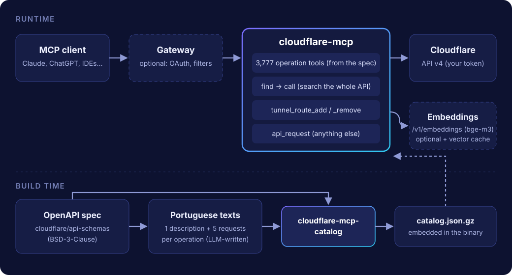
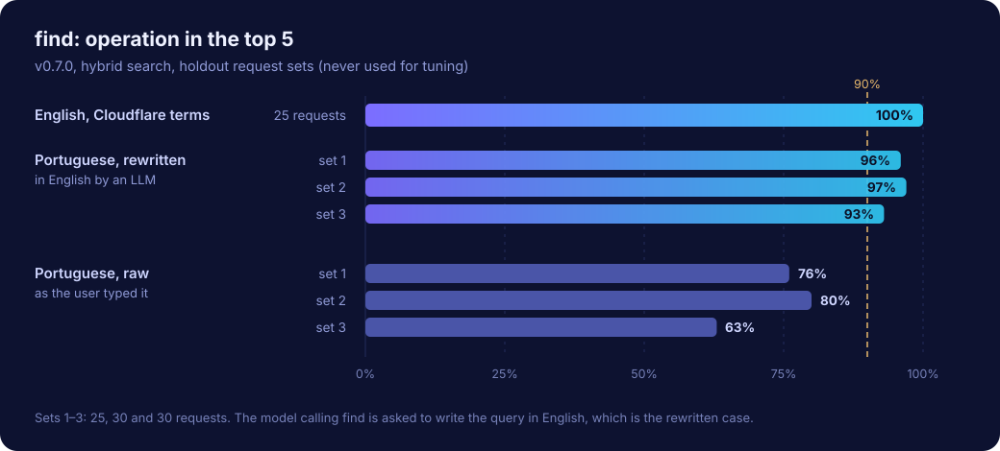

<div align="center">


# cloudflare-mcp

**The whole Cloudflare API as MCP tools, and a search that finds the right one.**

An unofficial [MCP](https://modelcontextprotocol.io) server in one Go binary: every Cloudflare API v4 operation as a typed tool, plus `find` and `call` so a model can reach any of the 3,777 operations without loading them all.

[](https://github.com/vitoramaral10/cloudflare-mcp/actions/workflows/ci.yml) [](LICENSE)   

[Website](https://vitoramaral10.github.io/cloudflare-mcp/) · [Quick start](#quick-start) · [How it works](#how-it-works) · [Tools](#tools) · [Docs](#documentation)

</div>

---

> [!NOTE]
> This is a community project. It is not affiliated with, endorsed by or supported by Cloudflare, Inc. Cloudflare's own server is [cloudflare/mcp-server-cloudflare](https://github.com/cloudflare/mcp-server-cloudflare).

Generic API servers give a model two tools, *search the spec* and *run some code*, and leave it to work out paths, bodies and IDs on its own. It often can't. cloudflare-mcp goes the other way: each operation is a tool with a real input schema, a description and a scope (`[zone]`, `[account]`), and the arguments a model gets wrong most are resolved for it. A zone can be passed as `example.com`, a tunnel by its name, and the account is optional.

```text
you   ▸ Block traffic from Russia on example.com
model ▸ find { "query": "WAF custom rule block country" }
        → rulesets_zone_entrypoint_update, rulesets_zone_rules_create, …
          tip: WAF custom rule in phase "http_request_firewall_custom",
               expression (ip.src.country in {"RU"}), action "block"
model ▸ call { "name": "rulesets_zone_rules_create", "arguments": { "zone_id": "example.com", … } }
```

## Highlights

<table>
<tr>
<td width="50%" valign="top">

**🧰 Every operation, typed**<br>
3,777 tools generated from Cloudflare's OpenAPI schema, named like the official SDKs (`dns_records_create`, `tunnels_config_update`). Bodies are flattened into top-level arguments, and `oneOf` variants are merged so the model sees every field.

</td>
<td width="50%" valign="top">

**🔎 `find` + `call`**<br>
Expose the tools you use daily and reach the rest through search. Hybrid ranking (embeddings and keywords), intent guides for tasks that map to generic mechanisms (redirects and WAF rules are rulesets), and usage tips in the result.

</td>
</tr>
<tr>
<td valign="top">

**🪪 Names instead of IDs**<br>
`zone_id` accepts `example.com`, `tunnel_id` accepts the tunnel's name, `account_id` defaults to the only account the token sees. Errors come back as text the model can act on.

</td>
<td valign="top">

**🚇 Tunnel routes in one call**<br>
`tunnel_route_add` reads the remote config, inserts the rule before the catch-all, writes it back and creates the proxied CNAME. `tunnel_route_remove` undoes it.

</td>
</tr>
<tr>
<td valign="top">

**🇧🇷 Portuguese, too**<br>
Each operation carries an LLM-written description and five user-style requests in Portuguese, so `find` ranks Portuguese queries by meaning. Measured, not guessed: see [search quality](#search-quality).

</td>
<td valign="top">

**📦 One small binary**<br>
Go, no runtime dependencies, catalog embedded. Streamable HTTP on `/mcp`, optional bearer auth, read-only and destructive hints on every tool. Docker image for `linux/amd64` and `linux/arm64`.

</td>
</tr>
</table>

## Quick start

1. Create a [Cloudflare API token](https://dash.cloudflare.com/profile/api-tokens) with the permissions you want the model to have (see [SECURITY.md](SECURITY.md)).
2. Run the server:

   ```sh
   docker run -d --name cloudflare-mcp -p 127.0.0.1:8080:8080 \
     -e CLOUDFLARE_API_TOKEN=... \
     -e MCP_BEARER="$(openssl rand -hex 32)" \
     ghcr.io/vitoramaral10/cloudflare-mcp:latest
   ```

3. Point an MCP client at it. With Claude Code:

   ```sh
   claude mcp add --transport http cloudflare http://127.0.0.1:8080/mcp \
     --header "Authorization: Bearer <the MCP_BEARER value>"
   ```

That gives you every operation, and `find` in keyword mode. For semantic search, add an embedding server and the precomputed vectors from the release; [Getting started](https://vitoramaral10.github.io/cloudflare-mcp/getting-started) walks through it, and [`docker-compose.example.yml`](docker-compose.example.yml) runs both services.

> [!TIP]
> 3,782 tools are too many for any client to show at once. Expose a curated set plus `find` and `call`, with your client's tool allow-list or an MCP gateway. [Using the tools](https://vitoramaral10.github.io/cloudflare-mcp/usage) has a starter set of about 55.

## How it works



- **Build time.** `cloudflare-mcp-catalog` reads the OpenAPI schema, resolves `$ref`s, merges `oneOf` bodies, collects enum values (zone setting names appear only in responses) and writes `catalog.json.gz`, which the binary embeds. The Portuguese texts come from `scripts/gen_pt_texts.py`.
- **Runtime.** Each operation becomes a tool. A call resolves names to IDs, builds the path, the query (including `name.exact=…` style filters) and the JSON body, and returns Cloudflare's `result` and `result_info`.
- **`find`.** Each operation is indexed as its own text plus five requests: 22,662 vectors. A query is ranked by its best-matching vector and by keyword, the two rankings are fused (RRF), and intent guides put the right mechanism first. Without an embedding server it falls back to keyword search.

## Tools

| Tool | What it does |
|---|---|
| *3,777 operation tools* | One per Cloudflare API v4 operation, e.g. `dns_records_list`, `zones_settings_edit`, `zero_trust_access_applications_create`. Descriptions start with `[zone]`, `[account]` or `[user]`. |
| `find` | Searches all operations for a task and returns names, descriptions, argument schemas and tips. Queries work best in English with Cloudflare terms. |
| `call` | Runs an operation by the name `find` returned. |
| `tunnel_route_add` | Publishes a hostname on a Cloudflare Tunnel: ingress rule before the catch-all, plus the CNAME. |
| `tunnel_route_remove` | Removes a hostname's ingress rule. |
| `api_request` | Raw API v4 call, for anything else (for example non-JSON bodies such as Worker uploads). |

Full reference: [Tools](https://vitoramaral10.github.io/cloudflare-mcp/tools).

## Search quality

`find` is measured against fixed sets of requests with known answers (`internal/cloudflare/testdata`). The holdout sets were written before the changes they measure and never used to tune the glossary or the guides. Share of requests whose operation is in the top 5:



Raw Portuguese stays well below English because some requests don't name anything an operation says ("let only the office IP into the panel" is an IP access rule). Rewriting the request in Cloudflare's terms fixes that, and the model calling `find` is the natural one to do it, so the tool asks for English queries and says so when it gets Portuguese. Details in [How find works](https://vitoramaral10.github.io/cloudflare-mcp/search).

## Configuration

| Variable | Default | |
|---|---|---|
| `CLOUDFLARE_API_TOKEN` | required | API token the server acts with. |
| `CLOUDFLARE_ACCOUNT_ID` | | Default account. Without it, the only account the token sees. |
| `MCP_BEARER` | | If set, `/mcp` requires `Authorization: Bearer <value>`. |
| `ADDR` | `:8080` | Listen address. `/healthz` answers `ok`. |
| `EMBED_URL` | | OpenAI-compatible embedding server (`/v1/embeddings`). Empty: keyword search only. |
| `EMBED_MODEL` | `bge-m3` | Model name sent to the embedding server. Part of the cache key. |
| `CACHE_DIR` | | Where the vectors are cached (~93 MB). Without it they are recomputed on every start. |

## Documentation

- [Getting started](https://vitoramaral10.github.io/cloudflare-mcp/getting-started): token, server, client, semantic search.
- [Using the tools](https://vitoramaral10.github.io/cloudflare-mcp/usage): naming, arguments, `find` and `call`, a starter tool set.
- [Tools](https://vitoramaral10.github.io/cloudflare-mcp/tools): the own tools and the operation catalog.
- [How find works](https://vitoramaral10.github.io/cloudflare-mcp/search): ranking, guides, Portuguese, evaluation.
- [Running in production](https://vitoramaral10.github.io/cloudflare-mcp/operations): Docker, memory, the vector cache, updating the catalog.
- [Architecture](https://vitoramaral10.github.io/cloudflare-mcp/architecture): how the pieces fit.

## Contributing

Issues and pull requests are welcome; see [CONTRIBUTING.md](CONTRIBUTING.md). Report vulnerabilities privately, as described in [SECURITY.md](SECURITY.md).

## License

[MIT](LICENSE). The operation catalog is derived from [cloudflare/api-schemas](https://github.com/cloudflare/api-schemas) (BSD-3-Clause); see [NOTICE.md](NOTICE.md).
